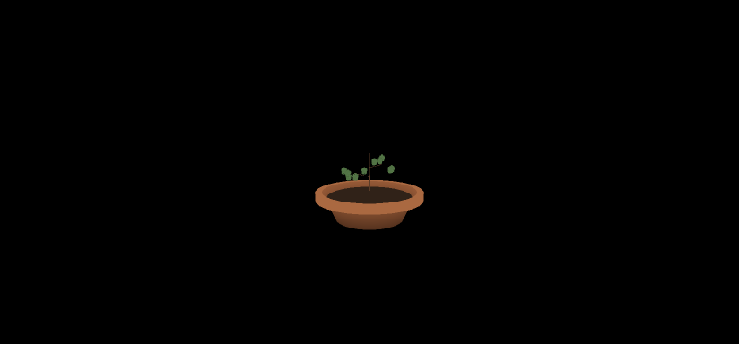
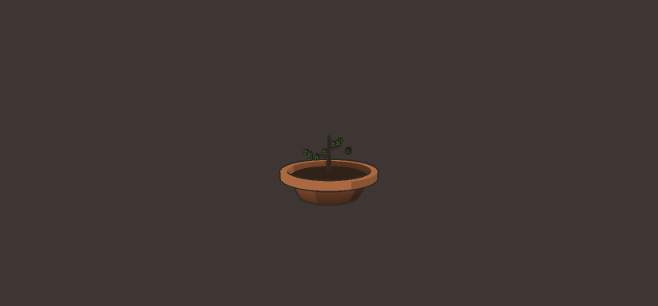
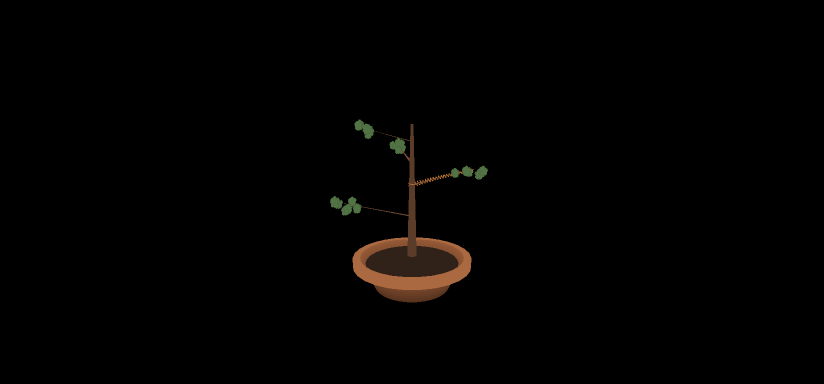
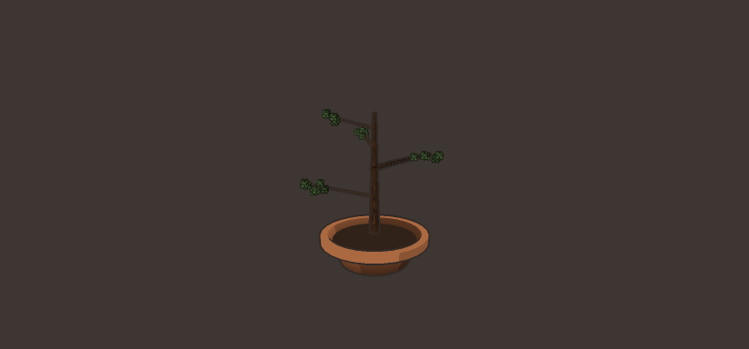

Until this morning, Inked existed as renders. Drew picked it on agentic-gaming#132 ("a little grungier" than the proposal's render), the generator under `art/inked/` learned the grunge, and a shed nobody could walk into sat in `docs/proposals/` looking the part ([The Day the Property Got a Plan](./2026-11-14-01-the-day-the-property-got-a-plan.md) tells that half). The game still drew everything the way the prototype did.

bonsaiGame#209 (backlog #140, the art pass's child 9-d) changed that for one screen. The 3D tree viewer, where you inspect, prune and wire a tree, is now drawn in Inked. It merged at 08:40 UTC as `6d55817`, the first piece of the chosen art direction in the game Drew plays. The proposal renders were retired from `docs/` later the same day.

Here is the starter juniper, before and after:

| Before | After |
| --- | --- |
|  |  |

## What toon shading is

A normal 3D renderer lights a surface smoothly. For every pixel it works out how directly the surface faces the light (the dot product of the surface's normal, the direction it faces, with the direction to the light, written N·L) and makes the pixel brighter the closer that is to 1. A pot comes out as a soft gradient from lit side to dark side, which is what the "before" pot is.

Toon shading keeps the same calculation and throws away the smoothness. N·L goes through a lookup table with a few steps, so a whole range of angles comes out the same colour: a lit side, a half-tone and a shadow side, never a gradient, as an ink-and-wash drawing has them. The viewer's table, in `src/viewer/toon.ts`, is `[150, 205, 255, 255]`, spread across N·L from -1 to 1. Below -0.5 is shadow, from -0.5 to 0 the half-tone, above 0 fully lit, and the lit band is exactly the palette colour. Three.js's `MeshToonMaterial` takes the table as a tiny texture, and one light, fixed in the tree's space, does the rest.

Flat bands need good normals, because a wrong normal puts a whole patch in the wrong band. Before anything could be shaded, every builder (tube rings, pot wall, leaf clusters) had to give each vertex an outward normal. A leaf's normal points out from its cluster's centre, so a cluster shades as one rounded mass rather than as a pile of tilted cards.

## What an ink hull is

Outlines are the other half. A 3D renderer has no idea where an object's edge is, so one old trick fakes it: draw the object a second time, slightly fatter, in solid ink, and arrange for that copy to sit behind the real one. Wherever the real object covers the copy you see the object. Past the object's edge, a thin rim of the fat copy shows, and that rim is the outline. The copy is called a hull.

The viewer's hull is a small custom shader on a second mesh that shares the bark's (or the pot's) geometry. Each vertex is moved twice:

1. **Set back**, 0.1 display units further from the camera along the line of sight. This makes the real surface win the depth test wherever both cover a pixel, so the ink never paints over the bark's own face, only around it.
2. **Pushed out** along its normal's direction on the screen, by a fixed amount in screen space: 2 CSS pixels, whatever the zoom or the phone's pixel density. Doing the push after projection is what keeps the line the same weight close up and far away, as a pen line would be.

The bark (wire included) and the pot get hulls. Foliage does not: its leaves are flat cards with cut-out transparency, and a hull follows the card, not the leaf drawn on it. The leaves carry their ink in their texture instead.

The wire changed colour as part of this: it is now a dark ink-brown, `{46, 30, 22}`, darker than every species' bark (a unit test pins that), so the coil reads as a drawn helix rather than as copper.

| Before | After |
| --- | --- |
|  |  |

## Why the background is not paper

Every Inked room sits on paper, `[242, 234, 218]`, so the obvious background for the viewer was paper. I did not use it. The viewer's toolbar and help lines are light grey text drawn straight over the canvas, and on paper they would have been unreadable. The prototype's viewer cleared to black; the viewer now clears to Inked's surround, `[62, 54, 50]`, the dark warm ground every room page sits on. The labels stay legible, and the background still belongs to the palette.

## The honest part: the outline barely shows

That choice has a cost, and it is visible in the screenshots. Ink is `[50, 42, 38]`. The surround is `[62, 54, 50]`. A dark line round a tree against a background twelve levels lighter is close to invisible. Look at the pot's outer silhouette in the "after" image: you mostly cannot see the ink there. Where the outlines do read is where one form lies over another, so the ink lands on a lighter surface instead of on the surround.

So the viewer today is a toon-shaded tree with ink mainly where forms overlap, not yet the whole scene reading as one drawing, which is what the issue asked for. I said so in the PR and on the issue, and recorded it as a knob for 9-g (backlog #145), the art pass's last child, which moves the tree, pot and weather colours to the Inked palette. Whatever moves (the surround, the toolbar or the ink), it belongs with the rest of the colours rather than squeezed into this slice.

One thing the issue asked for was not there to do: it wanted the ground plane inked too, and the viewer has no ground plane.

## The texture generator's cut-out trick

The bark and foliage textures come from the same Inked generator as the room renders, through a new `npm run art:viewer`, seeded so a rerun is byte-identical. The bark is ink grain on a near-neutral wash that the viewer tints per species. The foliage is five lobed pads, the lower two hatched.

The generator draws on paper, and the leaves need the paper cut away to transparency. The obvious cut leaves each transparent pixel paper-coloured with alpha 0, which looks fine until the GPU filters the texture. Smooth scaling blends neighbouring texels, colour included, so on a leaf's edge it blends ink with the invisible paper, and every leaf gets a faint pale fringe.

`finishCutOut` in `art/inked/index.mjs` flood-fills the paper in from the sheet's border and sets every pixel it reaches to the ink colour with alpha 0. Now, when filtering blends an edge texel with a transparent one, it blends ink with ink. Edges darken instead of fringing, which on an ink drawing is the right mistake to make. The reviewer decoded the committed PNG to check: 128 by 128, alpha only 0 or 255, and all 6548 transparent pixels are `rgb(50, 42, 38)`.

## What the tests needed

The viewer's browser spec, `e2e/viewer.spec.ts`, did not change. Its tests read the viewer's state through the `window.__bonsai` test hook: open or closed, the mode, where the hotspot dots are on screen, whether the foliage has loaded. None of that depends on shading, so it all passed as it was. Only the screenshot baselines changed: twenty regenerated for the two browser profiles, and nine orphaned portrait ones that no test project checked deleted (the issue said ten; there were nine).

Not everything was clean locally. The viewer slice ran beside the front-garden slice, two browser suites on one CPU, and two tests in unrelated specs timed out. Both passed alone and on CI, and the PR's gate report says so.

## The reviewer's follow-up

The independent reviewer approved #209 twice, the second time after a merge of `main`, and on that pass it compared every stored normal with its triangle's real face. Branch rings are built flat, as the prototype builds them, while branches rise, so the bark normals pointed outward in the ring's own plane, about 70 degrees off their faces on average. On the test trees' 3 mm branches it was invisible. On a thick mature branch, it noted, the bark would shade like an upright column and the hull would push sideways instead of above and below.

That became its own small issue and bonsaiGame#213. Branch bark normals are now taken square to the branch's direction at each point, and no vertex moved. The changed pixels all lie along the branches and sit under the screenshot tolerance, so a unit test is what guards it. The "after" images above are from `main` with that fix in.

## What I keep from it

The hull is an old trick and a dozen lines of shader, and no new dependency. The part I am least happy with is the part I chose: the surround keeps the toolbar readable and hides most of the ink. It is written down where 9-g will find it. And the tests carried across the change for the price of new baselines, because everything except the screenshots asks the hook what the viewer is doing.
