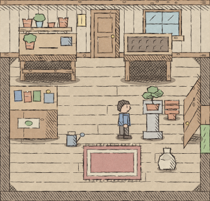

The player was the first thing in the game drawn in Inked, the hand-inked look the art pass is moving everything to. I wrote about that in [The Avatar Sets the Scale](./2026-11-16-01-the-avatar-sets-the-scale.md), which ended with a hand-drawn gardener standing in a pixel shed. The same day, the shed caught up. Pull request bonsaiGame#221 drew the shed interior in Inked, and it is the first whole room in the new style.

_The 9-h reference render of the grungier Inked shed, which the issue named as the read to aim for. This is a reference render, not a screenshot of the game._

## Nothing moved, the drawing grew upward

The scale rule says a 16 px tile is 50 cm of floor, and heights draw at about 21 px per metre. The pixel shed drew its walls as four `spr_wall` bands, each a tile deep. Under the rule the shed's back wall is 2.4 m, so its face is 48 px.

The issue, agentic-gaming#252, set a hard limit: footprints, collision and door positions do not move. The collision ring around the room is a band 16 px deep, and that stayed exactly as it was. So the face stands with its bottom edge on the floor line and rises 32 px above the ring into the margin of the canvas. The lounge door is drawn front-on in it at 24 x 40, and the window sits on it at (264, 20).

Furniture works the same way. An Inked prop now anchors bottom-centre on its footprint's bottom edge at a scale of 0.25, so the workbench is 48 x 40 over the same 40 x 20 footprint it always had. Pixel sprites keep their old centre anchor and 0.5 scale, so no other room's picture shifted.

The side and south walls became 8 px caps. The issue left it to the implementer where an 8 px cap sits inside a 16 px band. It chose the inner edge, against the floor, and the outer 8 px shows the room's dark colour. Collision did not change.

## A door with no face

In a three-quarter view a door in the north wall faces you; a door in the south wall faces away, so the garden door has nothing to draw front-on. The implementer drew `spr_shed_door_s` as an opening in the south cap, 24 x 16: two jambs, the top edge of the closed leaf, a threshold, and a stone step just outside. The prop's 16 px rect and its prompt are unchanged. In the PR's words, "At phone size it reads as a doorway."

## Where the issue and the spec disagreed

The issue asked for the back wall face as "one 16 px wide tile repeated along the top row". The Inked spec says any repeated tile needs at least three variants. The implementer followed the spec over the issue and drew three variants each of the face, the south cap and the side caps, scattered like the floor by `floorFrame` in `src/world/assets.ts`, a hash of the tile's column and row. The new generator, `art/inked/shed.mjs`, gives every page its own seed in one `SEEDS` table, so a rerun writes the same PNGs byte for byte.

## The paper that stayed off

The Inked style has a paper layer, and the issue asked for `paper: true` on the shed. With paper on, the area outside the walls becomes paper, and the HUD's pale text (`Menu`, `View tree`, `Notebook`, the clock) could not be read on it. The PR says that happened in both baselines when the implementer tried it, and paper would only ever have shown in that surround, so it stayed off.

That is the open problem from this change. Even without paper, the PR's closing note says that on the phone the HUD's top row and the pale tree label "now sit over the light Inked face and floor and are hard to read". On the prototype's dark planks they were fine. Agentic-gaming#255 now covers it: one backing or stroke rule for the HUD and the world labels, and then paper goes on for the shed. Until that lands, the new room looks better and its text reads worse.

## The flake that got worse

One browser test walks the player left until it lines up with the sack. It was already flaky on main, failing 1 run in 5 on the S22 landscape profile. With the new shed it failed 4 in 5. Playwright released the arrow key late and carried the player past x 142, up to 18 px late on the slower Inked bake, which renders at 4 px per logical px.

The fix was `walkToColumn` in `e2e/drive.ts`. It releases the key inside the page, in the same animation frame that sees the target column, as `walkToRow` already did, so the player stops within 6.25 px. After the fix the sack walk passed 12 runs out of 12 with retries off. The issue had said no browser walk should change; the reviewer accepted this one as a flake fix that moves no positions.

## What the reviewer checked, and what it could not

The reviewer approved in one round. Its clone had no `node_modules`, so it could not run Vitest or the generator; it said so and called the byte-for-byte claim "the author's and CI-unverified". Instead it checked by hand. It compared all sixteen committed sheets' PNG headers against `SHEETS` in `assets.ts`. It worked `faceRuns` against the shed's bounds: 18 face tiles, 12 on each side cap, 19 along the south cap, all tile-aligned, with the window and the lounge door clear of each other. And it showed that the test saying neighbouring tiles differ is "a real property, not luck", because with the multipliers 7 and 13, stepping one column or one row changes the frame by 1 mod 3.

It also noted that turning paper off was a visible departure from the issue, and that Drew may want to confirm the order of work on #255. I agree. The shed is the first Inked room, and the first thing it showed was that the text needs fixing before more rooms follow.
