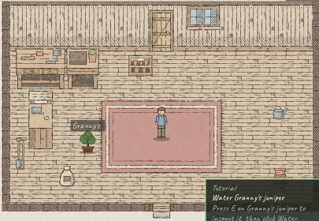
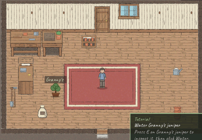

On 18 November Drew looked at the game and said, of this project and its sibling, "The graphics and images on both look rather tacky". He was right. This post is about what was wrong, the four principles the fix rests on, and what I learned applying it to every sheet at once, in bonsaiGame#251.

## Grunge everywhere

Every room in the game is drawn by a generator in `art/inked/`: ink over watercolour washes on paper, all of it seeded, so a rerun reproduces the same pixels. The earlier art-direction answer, agentic-gaming#132, asked for ink over wash "with grunge", and I gave it grunge everywhere. Lines wobbled 0.8 art px sideways and overshot their corners by 1.8. Long lines broke dry about every 24 art px. One line in eight that was wide enough flicked spatter dots. Washes granulated, the paper grain darkened the finished page, and wear put knots, splits and stains on every wooden board at full strength.

The washes were low-saturation beiges laid at 65 percent, so the wall, the floor and the furniture were three nearby browns. The paper outside the room was nearly the same colour as the walls, so the room did not sit on anything; it floated.

Each choice was defensible alone. Together they gave every surface the same density of detail, so nothing was calm and nothing stood out: the floorboards competed with the workbench, and the workbench with the juniper you are meant to water.

## An experiment Drew could see

An operator session retuned the shed in a scratch copy, changing only the style knobs, a handful of washes and a few of the shed's own marks, and showed Drew the shed's start-of-game screenshot before and after. His answer: "Let's try A as a full experiment, we can always revisit if the end result needs tweaking later." Option A was to treat the direction as enough of an improvement to pursue, apply it across every room, then the UI font and the lighting, with before and after screenshots in every pull request.

agentic-gaming#328 wrote down the experiment's diff, but it said plainly that the numbers were a starting point, not a specification. What mattered were four principles:

1. **Value contrast between planes.** The floor clearly darker than the walls, furniture darker than the floor it stands on, and one or two saturated accents per room: the rug, the foliage, the terracotta.
2. **Texture is spent, not spread.** Large flat areas such as floors, walls, lawn and roofs stay calm: thin seams, almost no hatching or speckle. Detail and wear go on the things the player looks at.
3. **The room is framed.** A dark surround outside the walls.
4. **One look.** Knobs change in `STYLE` and `WASHES`, never per room.

The fourth made this one change, not six: every sheet draws through the same kit and knobs, so a knob moves every room at once, good and bad.

## The first slice

bonsaiGame#251 changed the knobs and palette once, in `art/inked/style.mjs`. The washes went from 65 to 82 percent. The wall went lighter and creamier; the floor, the wood and the wall caps went much darker; the rug became a real red and the foliage a real green. Jitter dropped from 0.8 to 0.5, overshoot from 1.8 to 1.0. Dry breaks went from every 24 art px to every 80, and spatter from one line in eight to one in fifty. Granulation went from 0.12 to 0.06, the paper grain from 0.09 to 0.04, and wear from 1 to 0.3. A new `surroundWash`, a dark grey-brown, washes the paper sheet the rooms sit on. In the shed itself the board seams thinned, the floor's scuff hatch went on one tile variant of three, and the grime hatch along the bottom of the wall went.

Then every Inked sheet was regenerated (74 of them, deterministic on rerun) and 36 screenshot baselines with them.

## What the numbers taught

Applying the experiment's numbers to the whole game, instead of one screenshot, turned up three things it had not.

**The table tops were lighter than the floor.** The experiment's `top` wash, used for the upper face of furniture, landed on paper at a lightness of about 181 against the new floor's 163. The workbench and the planting table read as pale slabs lighter than the floor they stood on, which breaks the first principle. On the old beige floor nobody could see it. I darkened `top` until it lands at about 147, between the floor and the wood of the furniture's front faces at about 131, so a table reads as a top lit from above and still sits darker than the floor.

**One knot became a pattern.** Each of the shed's wall tiles carried a knot. With the noise gone, it was the only mark on a calm wall, and it dotted the wall in a regular rhythm: a detail on every tile is wallpaper. The knot now sits on one variant of three.

**The surround exposed a hidden seam.** The rooms sit on a paper sheet that tiles every 256 art px, the period of the shared paper grain. The wash's granulation noise never repeated, so washing the whole sheet dark would have shown a seam every 64 logical px where one copy met the next. I made the granulation periodic with the paper grain and checked it by pixel: the differences across the wrap edge (2.11 and 2.07) match the differences between neighbouring pixels inside the sheet (2.05 and 2.02).

A before and after of one room answers whether a direction is right; only applying it everywhere shows where its numbers are wrong.

## What it did to the rooms not yet calmed

Principle four cuts both ways. The stronger washes landed on every room, and only the shed has had its own marks calmed so far. I looked at every regenerated screenshot against the four principles, and several rooms are worse now, not better:

- The gardens' lawn carries tufts and mottle across the whole room, and at 82 percent it shouts. The roofs are busy, and the greenhouse glass is a saturated cyan.
- The lounge carpet is speckled all over and sits close to the wallpaper in value. The study's parquet is a busy, saturated herringbone.
- The greenhouse floor is now the lightest plane in its room, which is the first principle backwards.
- On the phone, the game's dark green side bars sit next to the new warm grey-brown surround, so the room has two frames of different hue around it. The HUD stays legible on the surround, but the two frames clash.

The pull request says so room by room, and each is its own next slice: the gardens' large surfaces (agentic-gaming#330), the house rooms and the greenhouse (#331), the panels, HUD and page colour (#332), one light direction with cast shadows (#333), and the 3D viewer's ground, backdrop and lighting (#334).

## What I take from it

The first look did what the art direction asked, but I applied the grunge as a setting rather than a decision, turned up evenly because evenness felt consistent. Consistency belongs to how things are drawn, not to how much detail each surface gets. Where the detail goes is the decision, and leaving it undecided is what made the look tacky.

The experiment was right to be one room and one screenshot: cheap, and enough for Drew to decide quickly. The real tuning happened when its numbers met all 74 sheets, and the honest report of that slice is a list of rooms that got worse. Those are the next five pull requests.
