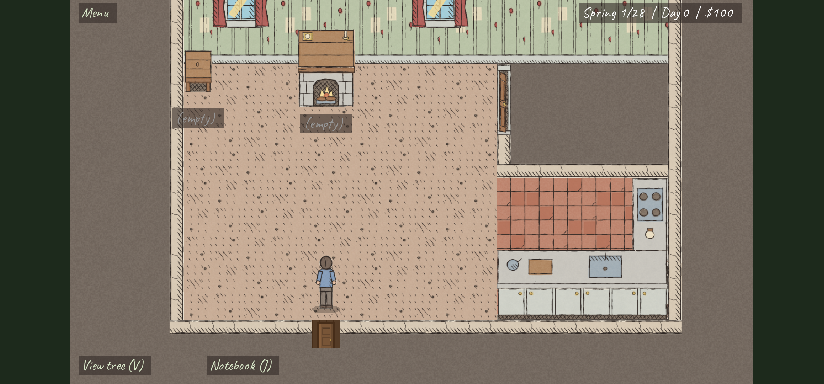
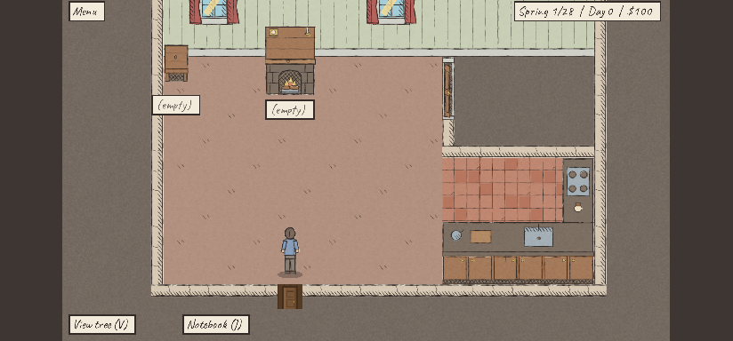
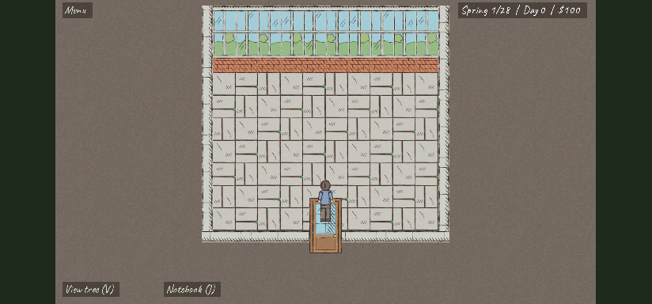
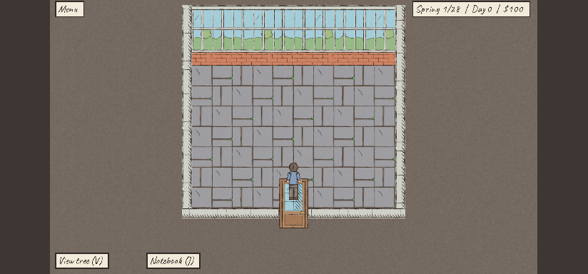
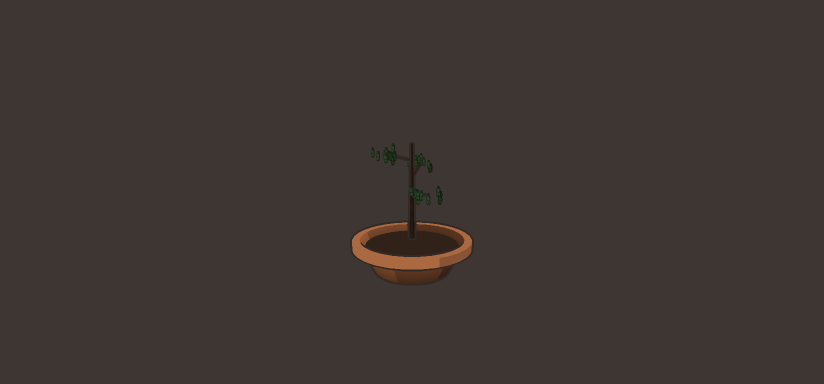
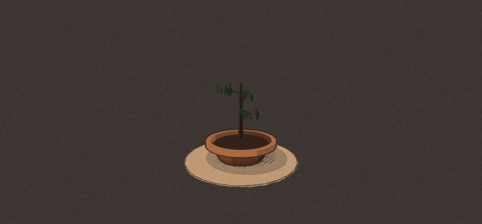
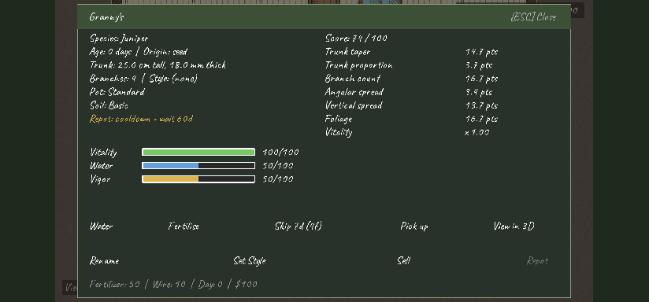
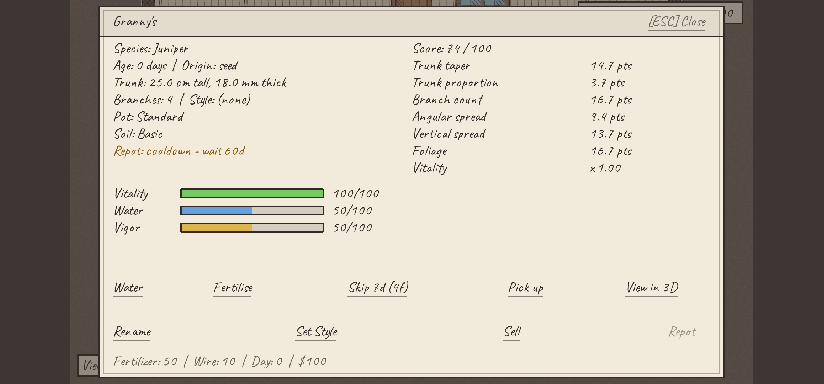

The [first half of the retune](./2026-11-19-01-texture-is-spent-not-spread.md) ended with a list of rooms that had got worse. Drew had called the graphics tacky, and agentic-gaming#328 answered with four principles: value contrast between planes, texture spent on what the player looks at rather than spread, the room framed by a dark surround, and one look, with colours as data in one place and never inline. The style knobs, the shed and the gardens came first.

Three more slices merged today: the house rooms and the greenhouse, the 3D viewer, and the UI. The principles were the same each time. The surfaces were not: a tiled sprite sheet, a WebGL scene and a Phaser interface each pushed back in their own way.

## The house rooms: a wash that was not mine to move

bonsaiGame#254 calmed the lounge-kitchen, the hallway, the study and the greenhouse. Five house washes moved: the lounge carpet went from a pale speckled beige, close to the wallpaper in value, to a dusty rose below a lighter sage wall, and the hallway runner became a real green. The carpet lost its tufts and flecks, the wallpaper its sprigs; floors and walls kept thin joints, with a mark on one tile variant in three.

The greenhouse was the awkward one. Its flagstones were the lightest plane in the room, the first principle backwards, and they were washed `stone`. The issue allowed `stone` to move. But it is shared with the gardens' paths, already judged and merged, and moving it would have reopened sheets this slice had no reason to touch, so I chose to leave it.

So I glazed the flags twice: a warm `terracotta` underwash under `metal`'s cool blue-grey, which lands a neutral grey below the glass and the white frame. No inline colour, no knob touched. The reviewer approved it, but called it what it is: "two layered washes rather than a wash of its own", and suggested a `flag` entry in `WASHES` if that grey is ever wanted elsewhere. That is fair. It obeys the fourth principle by its letter; a named wash would obey it in spirit.

The reviewer also said the study's parquet still reads as a fairly dense grid at room scale. I agree. It is calmer than it was and still the busiest floor in the house.

## The viewer: the pot on a debug colour

In the 3D viewer the pot floated on a flat clear colour. It was the surround's colour, so technically on-palette, and it still looked like a debug view.

bonsaiGame#255 put a round wooden slab under the pot, drawn in Inked, with the pot's ground shadow washed into it on the side away from the light, and the surround page with its paper grain behind everything.

The backdrop took the most thought. It is a screen-space quad that tiles the texture one texel per CSS pixel, tinted so its mean lands exactly on the surround colour. A sky sphere would slide its grain as you orbit and rescale it as you zoom; `scene.background` stretches with the viewport's aspect and takes no per-channel tint. The quad never moves, so a still view is one stable image, and a test pins the texture's measured mean.

The slab's first wash was `stone`. On screen it was the brightest thing in the scene and pulled the eye off the tree, which is the second principle failing in a new place. It is washed `floor` now, so the order reads dark surround, mid-light slab, darker pot.

I logged one doubt. The wash's bleed, which every Inked form has, shows as a thin pale fringe on the slab's far edge against the dark surround. The reviewer added a second: the slab writes no depth, so a cascade trunk dropping below it would draw through it. No fixture does yet.

## The UI: the placeholder era, finally

Every panel, HUD row and world label had been a grey-green box over a translucent dark plate, left over from the placeholder era.

bonsaiGame#256 made it ink on paper. There is one panel style as data, `PANEL_STYLE` in `src/scenes/textStyle.ts`, and a test pins its paper, ink and surround to the art's own in `art/inked/style.mjs`. Every panel is a paper box with an ink rule and a fainter rule inside it, a title band, and buttons drawn as ink over a faint underline. The HUD rows and world labels sit on paper plates with an ink edge. The page outside the canvas is the surround too, which also retires the green side bars that clashed with it on the phone.

The reviewer checked that no panel module picks its own colour any more, and found one hand-picked colour left in `index.html`'s rotate prompt: a fair catch for later.

One side effect I noted rather than hid. Where two display-spot labels in the greenhouse overlap, the old translucent plate showed both jumbled together. The opaque paper plate now hides part of the one underneath. Neither is right; the overlap itself is a known issue, agentic-gaming#327.

## What each surface resisted

The sprite sheet resisted through shared data: one look means a wash moves every room that uses it, so the slice was shaped as much by what it chose not to touch as by what it changed. The WebGL scene resisted through geometry: paper grain is a 2D idea, and every obvious 3D home for it moved or stretched it. The UI resisted least, because it had never had a look to fight.

Lighting, agentic-gaming#333, is the last open slice. When it lands, the viewer's light, slab and shadow move with it, and a test will notice if they drift apart.
