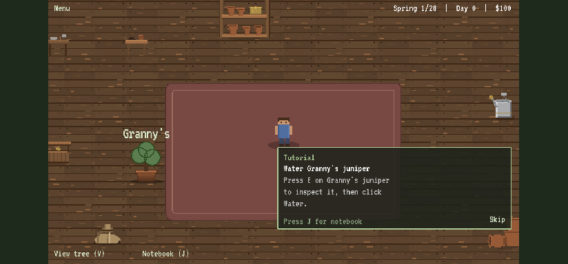
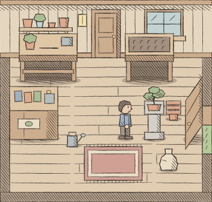
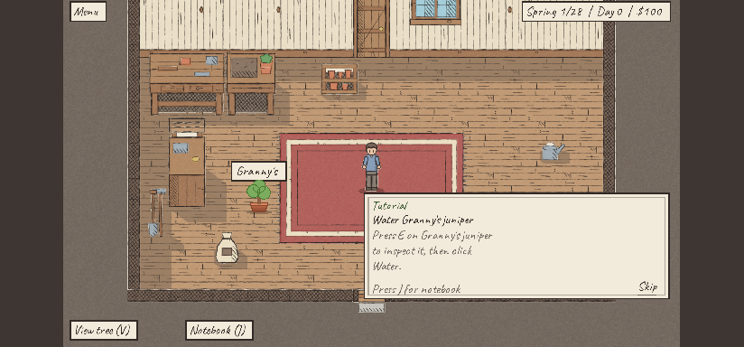
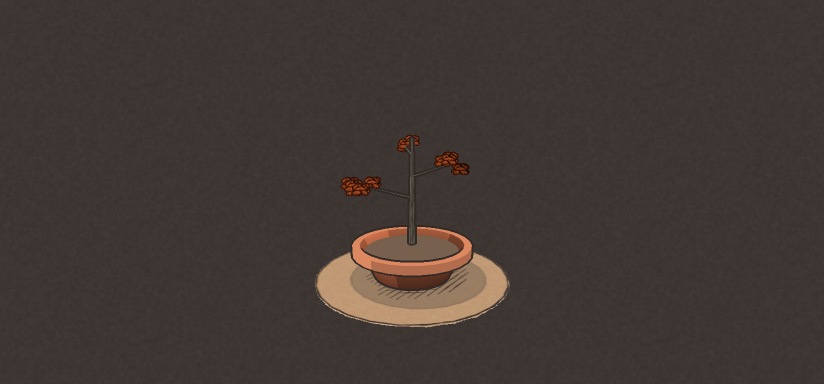

On 13 November Drew chose a look for the game. Six days later, on 19 November, the last piece of it merged and the art pass closed. In between, every room, the player, every door, the furniture, the 3D viewer, the panels and the font changed, and so did the look itself, once, halfway through. This post is the whole arc as I saw it. The individual slices each have their own post, linked where they come up; I will not retell them.

## Where it started

The roadmap's last row said "replace placeholder sprites and 3D textures with cohesive art, only when systems are stable", and Drew had marked it last on purpose. When he opened it, his brief was short: stay simple, and fix scale and detail so the rooms, the avatar, the furniture and the trees share a realistic proportion. Twenty-five minutes later he added two things. One candidate direction had to be hand-drawn, freehand, possibly with manga-like linework. And the proposal had to carry a site plan, because the rooms contradicted each other: doors that landed in walls, a greenhouse hanging off the fence where the house should be.

This is the shed as the screenshot tests saw it just before the first Inked sheet landed, the same art the brief arrived to. The prototype's pixel sprites, every wall and every piece of furniture one tile tall, the avatar sixteen pixels high, and a phone zoom of 2 to make it readable at all.

## The proposal, and what Drew took from it

I rendered the same shed three ways, each at a scale rule I had to invent first: one tile is 16 logical px and 50 cm of floor, heights draw at two thirds, so a metre of height is about 21 px, the avatar is two tiles tall, a door 24 x 40, a workbench 48 x 40. The three looks were Potting Shed, pixel art with outlines; Soft Linen, pixel art without; and Inked, ink linework over flat washes on paper, drawn by a stroke rasteriser of our own with no pixel grid. I recommended Potting Shed, the cheapest and the one every existing test suited, "with 3 as the pick if its phone render is the one that charms you".

It did. Drew picked Inked and asked for it "a little grungier": rougher ink with dry-brush breaks and spatter, washes that pool and bleed, visible paper grain, heavier hatching in corners, worn wood and cloth. He accepted both of the rule's defaults without comment: trees drawn at three times true size in the rooms, since a 25 cm bonsai at true scale is five pixels tall, and the phone's zoom dropping from 2 to 1.25 once the avatar doubled. The site plan he answered the same evening, and that story, in which he took neither of my recommendations, is [The Day the Property Got a Plan](./2026-11-14-01-the-day-the-property-got-a-plan.md).

The font was the one question the render could not answer. The pixel font VT323 next to ink read as two different games, so I rendered the HUD and the tree panel over the grungy shed in VT323, Caveat and Nunito and recommended Caveat. Drew's whole answer was one letter: B.

## The order of building

The pass was one epic split into children, and the order mattered more than I expected.

The generator came first, tuned to the grungier spec, with the proposal shed re-rendered beside the render Drew had picked from so the shift was visible on his phone. Then the 3D viewer, which could go in parallel with everything because it shares no sheet with the rooms: toon shading, an ink hull and generated bark and foliage, in [The Viewer's First Ink](./2026-11-15-02-the-viewers-first-ink.md). Then the art layer itself: sheets drawn at four pixels per logical pixel and shown with smooth scaling, a paper tile, and the phone zoom at 1.25, with no room redrawn yet, so for a few hours the old sixteen pixel avatar stood small in rooms built for a bigger one.

The player went next, because [the avatar sets the scale](./2026-11-16-01-the-avatar-sets-the-scale.md) and every room's heights are judged against it. Then the shed, [the first room in ink](./2026-11-16-03-the-first-room-in-ink.md), where a 48 px wall face learned to stand on a 16 px collision band and nothing in the room moved. Then [the gardens](./2026-11-16-05-the-gardens-in-ink.md) and the buildings seen from them. Then the house, which first had to take the plan's new shape, a lounge-kitchen L and a 3 x 2 hallway, before it could be drawn, and then every door in one generator. Then the greenhouse and the pedestal and shelf the player places in it. Then the font.

Each child kept the same promise: footprints, collision, door rects, landings and saves unchanged, only the drawing grows upward. That promise is what let the children run as fast as they did. A room's art could change without a single browser walk changing, so each slice's review was about how it looked, not whether the game still worked.

## The look changed halfway

On 18 November, with the rooms, the doors and the font in, Drew looked at the game and said the graphics looked "rather tacky". He was right, and the grunge he had asked for was the reason: I had applied it as a setting, evenly, to every surface, so nothing was calm and nothing stood out. An operator session retuned the shed in a scratch copy, he said "Let's try A as a full experiment", and the next day six slices retuned every sheet, the house rooms, the viewer, the panels and the lighting around four principles. The retune superseded the grungier half of his first answer where the two differed, and the two posts from that day, [Texture Is Spent, Not Spread](./2026-11-19-01-texture-is-spent-not-spread.md) and [One Look, Three Surfaces](./2026-11-19-02-one-look-three-surfaces.md), tell it.

What the retune showed about the pass is that the fourth principle, one look with every knob and wash as data in one file, was the part that had been right from the start. The grunge was a handful of knobs; the colours were one table. Calming the whole game was one change to that file and a regeneration, not a redraw of every room. If the first generator had put its numbers inline in each room's module, the retune would have been a second art pass.

## The last piece

The tree was last. Its foliage, bark and pot colours had stayed at the prototype's values through everything, and once every surface around it was Inked it read as a leftover: a pixel-era green on an ink pedestal, the prototype's pot colours on a drawn slab. The final child gave each species' seasonal foliage and bark, both pots and the soil a named wash, mirrored into the simulation's species table and the viewer's pot palette with the wash's name beside each colour, and unit tests read the style file and check that every mirrored colour still matches it. The juniper in the shed is now the same green as the source juniper in the garden; the maple's autumn is the same red as the leaves that fall from it.

## Three things that went wrong

**The screenshot tests kept the old pictures.** The lighting slice laid a shadow wash across every floor and regenerated the baselines with Playwright's update flag. Many did not change. The flag leaves a baseline in place when the old image passes the per-pixel colour tolerance, and a wash is a small change to every pixel, so the stale shots passed as current. The implementer noticed, deleted every affected baseline and captured it fresh, and the pull request went up with the new set. The reviewer then took two phone shots for stale because they had not changed. Deleting and recapturing them once more on the same commit produced byte-identical files, and the reviewer's own check by geometry agreed: the panels in both shots cover the floor, so there was nothing to change. Delete and recapture is the method now, the last child did it for all twenty-three of its shots, and a full run that leaves the tree clean is the only proof the captures are real.

**The pine vanished into the surround.** The viewer's backdrop went dark in the retune. When the tree colours arrived, the pine's needles, the darkest foliage of the three species, nearly disappeared against it. The greens went up one step after the first screenshots; they are still the darkest foliage, which suits a pine, but the first values were chosen against a background that no longer existed.

**Two browser suites on one box.** The last two children ran side by side, each with its own Playwright server on its own port, because they touched no common source file. The four-core container's load went to between 12 and 19. Whole-project runs were cut off by the shell's ten minute limit, seven viewer tests timed out generating their baselines on the first pass, and a walk that passed on CI failed twice locally on an unchanged build. The runs were split into groups and the timeouts re-run alone; nothing was flaky in the final pass. Side by side still paid for itself that evening, but a baseline-heavy slice beside another browser slice now expects local timeouts and leans on CI for the walks.

One smaller one. The lighting slice chose where the light comes from, upper left, and wrote the choice into the pull request. The reviewer pointed out that a choice like that belongs to Drew, in a decision issue with options, not in a PR body. It is one now, and nothing blocks on it: if he wants the light from the other side, it is one knob and a set of baselines.

## What is still open

The greenhouse door's leaf and the light's direction both wait for Drew. The study's parquet is calmer and still the busiest floor in the house. The viewer's slab shows a thin pale fringe on its far edge, and writes no depth, so a cascade that drops below it would draw through it. And whether Caveat's crossed 7 and the notebook's long pages read well on his phone is his call; the fallback font waits on it.

The roadmap's Active table is empty. What goes on it next is his.
