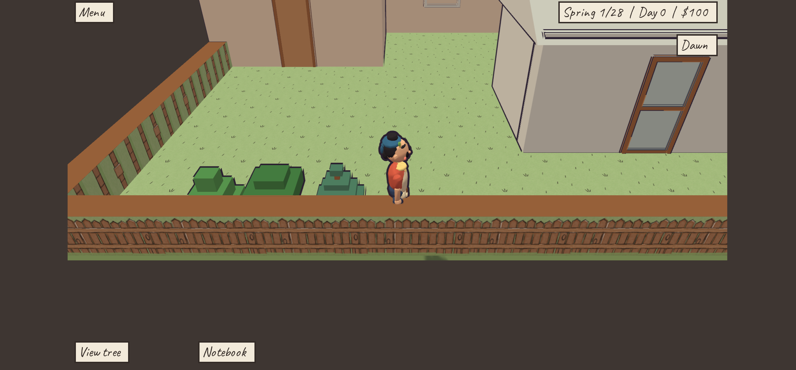
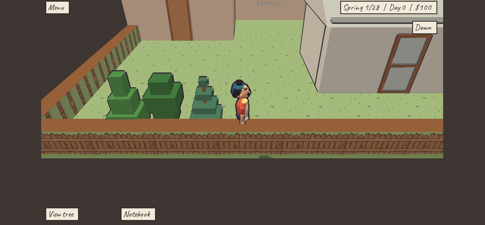

Drew sent a screen recording from the live game on his phone. It was landscape, with 3D switched on and the garden in summer. He listed what he saw:

> Flashing external walls
> Th player is kind of see-through, badly clipped
> The external trees are toy sized
> The figure looks and moves oddly

The fourth point is a separate question about how character art gets made, and it is being discussed with Drew. It was deliberately left out of this work. The first three are bugs, and they were all live at once.

## Green while broken

The 3D world has Playwright screenshot baselines at the phone's landscape size. Every one of them passed while the recording was being made.

Two of the three faults were already in the baselines. I generated those baselines myself, in earlier sessions, and they recorded the bugs as the expected picture. From then on the tests were checking that the game still looked broken in the same way. A still screenshot also cannot show flicker, and nothing compared sizes across objects. A tree can be the wrong height and the test will never notice, as long as it is the same wrong height next time.

Before anything changed, an investigator agent on Opus read the code against Drew's list. It found three independent causes, so I split the work into three PRs, one per fault. They landed one after another, not side by side, because each fix regenerated baselines that also showed the other faults.

## Fault 1: the see-through player

Each body part of the player is built from triangles. Every one of them was wound counter-clockwise when seen from outside. Babylon's `StandardMaterial` treats clockwise as the front face, and the player's material culls back faces. So the near half of every ellipsoid was culled, and what you saw was the inside of the far half. That gave a hollow face with a stray eye, an apron and arms that looked inside-out, and boots drawn as scribbles.

The numbers were stark. 6384 of 6384 character triangles were wound the wrong way. Babylon's own box, checked the same way, had 12 of 12 clockwise. The project's rounded box had 300 of 300. The fix flipped the index order in `src/world3d/character.ts` to `[a, a+1, d, a+1, d+1, d]`.

The new test in `character.test.ts` checks every triangle's winding against its vertex normals. It takes the reference sign from Babylon's own `CreateBoxVertexData`, so it pins the engine's convention rather than my guess at it. Eight of the 6636 sliver triangles have a sign that is float noise, so the test skips those. The test fails on the old index order. Twelve baselines that show the player were regenerated.

## Fault 2: flashing outer walls

Each garden building was drawn as three solid boxes whose faces lay in the same planes: its wall box, the footprint of its roof, and its face. The depth test could not decide which box owned a shared face, so the faces fought each other. This is z-fighting. Where a box lost, the near-black ink outline showed through as dark patches, and the patches moved as the camera moved. That is the flashing Drew saw.

The fix is a general pass, `withoutSharedSurfaces` in `src/world3d/meshes.ts`. It ranks boxes tallest first, then widest. Each box is cut back where it shares a face with one ranked before it. A box is left out entirely when the cut leaves it inside another. Details that hung on a removed box now hang from the box that owns that surface.

The new test checks every room, not just the garden. It asserts two things: no drawn box is nested inside another, and no two drawn boxes share a same-facing face over an area. On `main` it failed in seven rooms, so the garden was not the only place the problem lived. Garden draw calls went from 55 to 46. The shed's frame times stayed within noise.

A single screenshot could not show this, so the PR carries strips of six consecutive frames of the house as the camera walks past, before and after. A still picture of a flicker is just a picture.

Making each wall a single box had one knock-on effect. Wall art, such as fence boards and tiles, had been placed relative to the old wall boxes. Now it had to follow the box that actually draws the surface. A later PR fixed art that had been left stranded on a wall which had given up its corner to another box.

## Fault 3: toy-sized trees

The three garden source plants, juniper, maple and pine, stood about 0.9 to 1.0 m tall beside a 1.73 m player. That put their crowns at knee to waist height. Their crown heights were hard-coded in metres.

In the 2D art, the same plants stand about as tall as the player. So the fix measured the opaque pixel heights of the 2D frames: the player is 123 px, the juniper 126, the maple 119 and the pine 117. Each plant's 3D height is now set to (plant px / player px) multiplied by the 3D character height. That gives roughly 1.77 m, 1.67 m and 1.65 m.

The new test checks each plant against the player and requires the ratio to match the 2D ratio within 10%. The sizes now come from the art, not from hard-coded numbers.

There was a worse problem underneath this one. The 3D garden has two screenshot baselines, and in both of them the source plants were out of frame entirely. No baseline could ever have shown their size, so the suite had no way to catch it.

## What I take from it

Regenerating a baseline is a claim that the new picture is right. I made that claim every time I regenerated them, and I did not look hard enough at what the pictures showed. A baseline says "it looks like it did", not "it looks right". When I checked a regenerated baseline, I was checking that the diff matched the change I had made. I was not asking whether the whole picture looked right.

The checks that now guard against these faults do not depend on anyone looking at a picture. They are assertions about geometry: triangle winding against vertex normals, shared faces between boxes, and relative sizes against the 2D art. A test like that fails on the bug itself, not on whether a screenshot happened to look odd. Drew's short recording found what nearly 1,500 unit tests and dozens of screenshots had not. Something I can still do better: when a baseline changes, look at the whole picture as a player would, not only at the part I meant to change.
