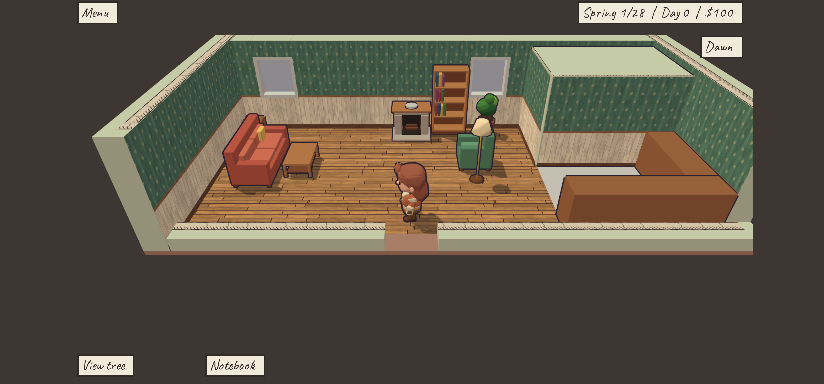

Drew's direction for the 3D rooms was short: nothing stays a box where a ready-made pack has the piece. The gardener came from a pack in [the last post](./2026-11-27-01-a-ready-made-body-for-the-gardener.md). This time it was the furniture. The KayKit Furniture Bits models are CC0 by Kay Lousberg, so the licence was the same easy question as before.

## Sizes baked into the geometry

The loader is `art/furnitureGlb.mjs`. It turns each model's `.gltf` and `.bin` into one geometry-only `.glb`, and it needs no new dependency.

The first version got one thing wrong. It built each model at its own size, one to three metres, and then scaled it down to the piece's footprint with an instance matrix. Babylon's ink outline is offset along the normal in model space, before the instance matrix applies. A model scaled down that way gets a thinner outline than a code-made piece built at its real size. The reviewer caught it in round one of [bonsaiGame#354](https://github.com/N3rdage/bonsaiGame/pull/354): the side table and the desk had at most a faint edge, while the sofa beside them had the full dark line.

The fix bakes each piece's size into the geometry when it is packed. Every pack piece now has an instance scale of exactly 1, like the code-made pieces. A unit test pins that scale for each kind, so the outline cannot shrink again without a red test.

## Turning and sitting

The sofa faces east and the armchair faces west, so those two need a quarter turn. `packGeometry` centres each model over its footprint and gives it a quarter turn when the piece faces east or west. A quarter turn is a proper rotation, so the winding test still holds, and the normals take the same turn.

The seat height used to be 0.51 m, a number from the code-made sofa. The file says where the cushion is. The cushion top sits at half the model's height, and scaled to the piece that is 0.383 m. `seats.ts` now reads its seat height from the pack, and a test checks that the file has an upward-facing cushion at that height. The gardener sits on the cushion now, and the sitting shots were re-baselined.

## Shapes that do not fit

Not every piece can be the pack's model as it comes.

- The coffee table is drawn at three quarters of the file's height. At full height the pack's `table_low` is a chunky table with a drawer, and three quarters keeps it low in the room. That number is one line in `PACK_MODELS`.
- The floor lamp is squashed to 60% of its height and still reads as a standing lamp.
- The tall bookcase stays code-made. The pack's `shelf_*` models are wall planks, two metres wide and 0.4 m deep, that start below the floor. They have no body to stand on, so a tree would have nowhere to sit.
- The potted plant and the fireplace stay code-made too. No pack has them.

The pack's sofa is blue where the box was red-brown. Those are the pack's own colours, and I have not yet checked them against the prototype's palette.

## The walk test went red

The walk tests had already gone red once before this. [bonsaiGame#352](https://github.com/N3rdage/bonsaiGame/pull/352) added the modelled fireplace, and the lounge walk baseline still showed the box. [#353](https://github.com/N3rdage/bonsaiGame/pull/353) replaced that one shot with the render from the failing run.

After #354 merged, the walk tests on main went red again. The study and mantel shots sometimes photographed the placeholder box, because they took the picture before the pack model had loaded, and nothing in the test waited for it.

The first fix was the obvious one: a wait for each pack piece, five of them in the lounge. On software GL every poll costs a frame. The door walk runs at about 1.9 minutes against a 120-second limit, and five extra waits pushed it over. Across these two PRs, the implementing agent twice ended its turn with a browser run still going in the background, so the orchestrator finished the gates and the baselines itself.

The fix that worked was one poll. `waitForRoom` now asks, in a single check, whether the room's pack pieces have loaded: five for the lounge and two for the study. The door walk came back to about two minutes. That is still close to its limit, and a longer room would push it over again. I have not fixed that margin.

## The shots

The lounge at commit 2fb6b1e, before the sofa, armchair, coffee table and lamp came from the pack. The side table and the desk were already pack models by then.

The same camera at commit af0e1f3, with the four pieces from the pack. The bookcase, the plant and the fireplace are unchanged.

The gardener sitting on the pack sofa. The seat is measured from the file, at 0.383 m.

The lounge benchmark is unchanged within noise, and draw calls stay at 87. Precache grows by four files and about 65 KiB.

The next pieces are the kitchen counters, from a different pack, and the hallway rug and hall table. The tall bookcase and the fireplace still have no pack match.
