# Art direction: a scale rule and three candidate looks

## Purpose

The art pass gives the whole game one new look (decision B on agentic-gaming#127). Before any room is redrawn, this proposal fixes the scale every sprite is drawn to and shows, rather than describes, three candidate art directions: the same shed, avatar, workbench, pedestal with its tree and doors, rendered at the Samsung S22 Ultra's landscape size so each can be judged on the phone.

## The scale rule

Logical canvas 480 x 270 px; one tile is 16 logical px, which is 50 cm of floor. The rooms are a three-quarter top-down view, so drawn heights are foreshortened: 1 m of height draws as two thirds of a metre, so 1 m tall is about 21 px. A piece of furniture draws as its front face (real height x 21.33 px/m) plus its footprint's depth for the top face, and furniture rounds to 4 px; the avatar and the front-on door round to the half-tile grid instead (see Rounding below). On phones the world zoom drops from 2 to 1.25 (see The phone zoom below). Everything in the game today is one tile tall (the avatar is 16 x 16, a door 16 x 16, a wall band 16 px), which is why rooms feel like sheds and the avatar like a toy; this rule fixes the proportion.

| Thing | Real size (w x d x h, m) | Footprint (logical px, w x d) | Drawn sprite (w x h) |
|---|---|---|---|
| Avatar | 0.5 x 0.3 x 1.7 | 16 x 8 | 16 x 32 |
| Door in a north wall (seen from the front) | 0.8 x - x 2.0 | 24 x 4 | 24 x 40 |
| Door in an east or west wall (seen side-on) | - | 8 x 24 | 8 x 40 frame on the wall cap, leaf drawn ajar into the room |
| Workbench | 1.5 x 0.6 x 0.9 | 48 x 20 | 48 x 40 |
| Planting table | 1.2 x 0.6 x 0.9 | 40 x 20 | 40 x 40 |
| Shop kiosk (counter) | 1.2 x 0.6 x 1.1 | 40 x 20 | 40 x 44 |
| Pedestal | 0.4 x 0.4 x 1.0 | 16 x 12 | 16 x 32 |
| Bookcase | 1.2 x 0.4 x 2.0 | 40 x 12 | 40 x 56 |
| Window in the back wall | 1.0 x - x 0.8 | - | 32 x 24, its bottom 16 px above the floor line |
| Back (north) wall face | 2.4 m high | - | a 48 px tall band across the room's top |
| Side and front wall caps | 0.25 m thick | - | 8 px bands |
| Starter bonsai, 25 cm in a 12 cm pot | at hero scale x3 | - | about 14 x 18 overall: a 10 x 5 pot under 11 to 13 px of trunk and foliage |

**Rounding.** The rule gives 36 px for a 1.7 m avatar and 43 px for a 2 m door; the table rounds both down to the half-tile grid (2 tiles and 2.5 tiles), as every 16 px game does, because a two-tile figure walks a 16 px grid cleanly and the door-to-avatar ratio it leaves (1.25) is the real one (1.24). Furniture keeps its top face's depth inside its drawn height (the workbench: 20 px of top plus 19 px of front), which is why a 0.9 m bench draws 40 px tall beside a 1.7 m avatar at 32.

**The hero-scale exception.** Trees on pedestals are drawn at three times true size. At true scale a 25 cm tree is 5 px tall and unreadable on a phone; the 3D viewer is where a tree is seen at its true size.

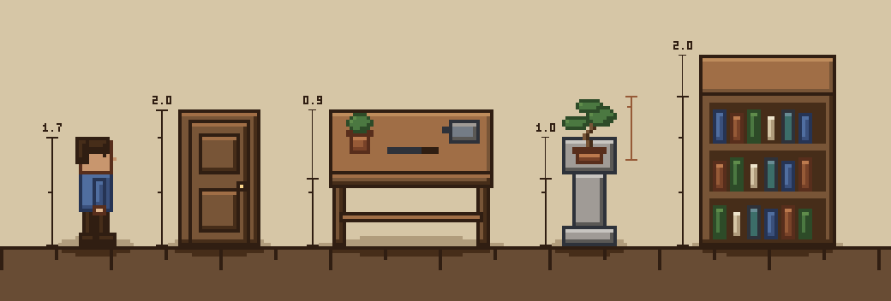

Each bracket measures the real height, from the floor to the top of the front face, ticks once per tile (16 px) and is labelled in metres. Above the furniture a thinner bracket marks the top face's depth, which the three-quarter view adds to the drawn sprite: that is why the 0.9 m bench's sprite stands taller than the 1.7 m avatar while its front face reaches his hip. The terracotta bracket is the bonsai at hero scale.

**The phone zoom.** The phone's game canvas is 4 device px per logical px (1080 / 270), and today the world camera doubles that on phones (`PHONE_WORLD_ZOOM = 2`), so the world draws at 8 device px per logical px through a 240 x 135 logical view that follows the player. That zoom exists because today's avatar is 16 px. With a 32 px avatar this proposal drops the phone zoom to 1.25, 5 device px per logical px: the avatar is 160 device px tall, still larger than today's 128 and about a seventh of the 1080 px screen, and the 384 x 216 logical view (12 x 6.75 m) shows a whole 6 x 4.5 m lounge at once instead of scrolling it. The desktop zoom (1) is untouched. The phone renders below are at 1.25.

**What changes in the game.** The player sheet becomes 16 x 32 frames. Doors become 24 x 40, or 8 x 40 side-on. Every furniture sprite is resized per the table. Walls become a 48 px back face plus 8 px caps, so every room's `bounds`, `walls`, door rects, landings and walk-tests in `src/world/*Room.ts` change in the plan's implementation children, and the "door row y 190" rule retires. `PHONE_WORLD_ZOOM` in `src/world/worldCamera.ts` goes from 2 to 1.25, a one-line change in the player child, with its phone screenshot baselines.

## The candidates

Every candidate draws the same scene: the shed at 5.0 x 3.5 m (10 x 7 tiles inside), a north door to the lounge, a side-on east door ajar to the garden, a window, a wall shelf of pots, the workbench, the planting table, the shop kiosk, the pedestal with the starter bonsai, the avatar facing it, a watering can, a sack, a stack of pots and a rug, each with a soft ground shadow, depth-sorted by footprint. The phone renders are 2318 x 1080 (the S22 Ultra's landscape device pixels): the 1920 x 1080 game canvas centred between the letterbox bars, the world at 5 device px per logical px (the proposed phone zoom of 1.25), no HUD.

### 1. Potting Shed (pixel, outlined, warm)

1:1 logical pixels, scaled nearest-neighbour. Every form has a 1 px outline in the darkest tone of its own material (never pure black) and three tones inside it (shadow, mid, highlight); no dithering, no anti-aliasing. The palette is ART_SPEC.md's 17 colours at their values, grown with outline tones, a cool slate for stone and metal, a cream for plaster and burlap and a warm lamp light: 32 colours. Produced in the repo as all the art is today: a Node script drawing pixels with `pngjs`, packed into sheets. Looks like Stardew Valley, Graveyard Keeper, Moonlighter. In the 3D viewer: a bark texture and a foliage sprite drawn in the palette.

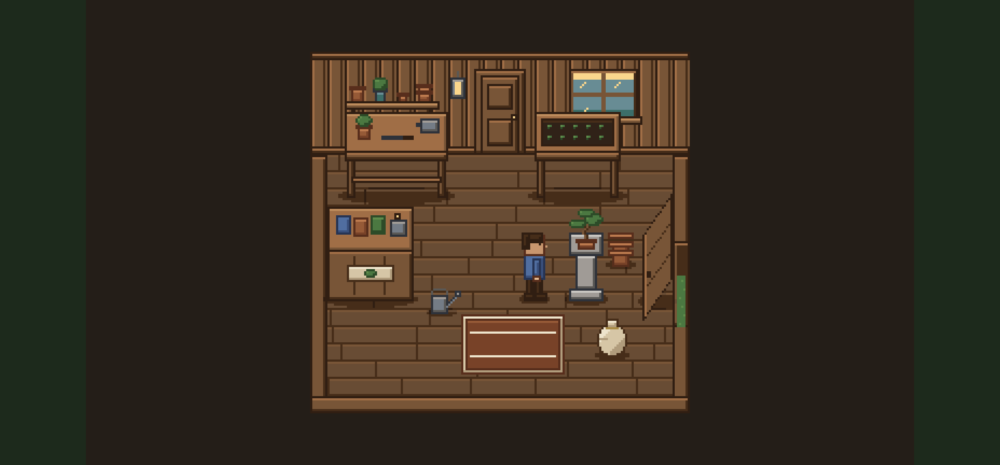

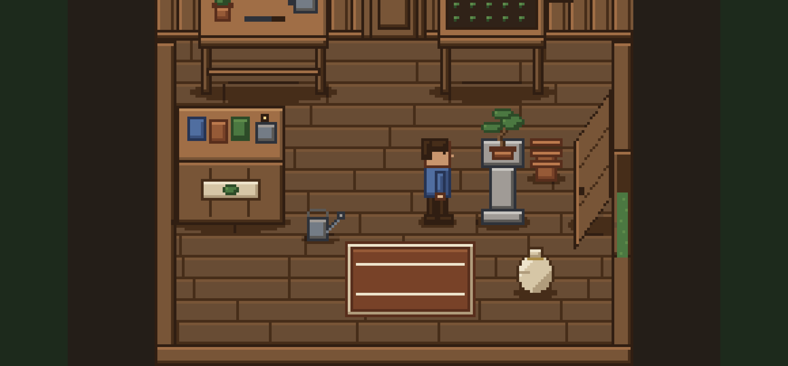

For comparison, the same scene at today's phone zoom of 2 (8 device px per logical px): the 240 x 135 logical view centred on the avatar and clamped to the room, as the world camera does. The avatar is about a quarter of the screen height and the view, clamped to the room's bottom edge, cuts off the top of the room: the back wall, the window and the shelf.

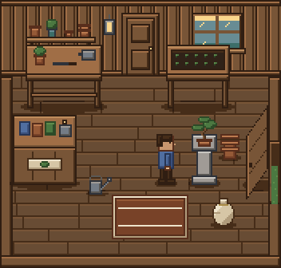


### 2. Soft Linen (pixel, no outlines, pastel)

1:1 logical pixels, scaled nearest-neighbour. No outlines at all: forms read by value steps, the lightest tone on the top and left of each form and the darkest on the bottom and right, corners rounded off. A 2x2 checker dither only inside large flat areas (the light falling from the window, the foot of the wall, the plaster's ceiling shade, the lamp's glow). A cooler, higher-key palette of sage, oatmeal, dusty rose, slate blue and warm grey: 24 colours. Produced the same way as Potting Shed (the two share their drawing code in `art/proposal/pixelScene.mjs`; only the style and the materials differ). Looks like Unpacking, Sprout Valley, Littlewood. In the 3D viewer: a bark texture and a foliage sprite drawn in the palette.

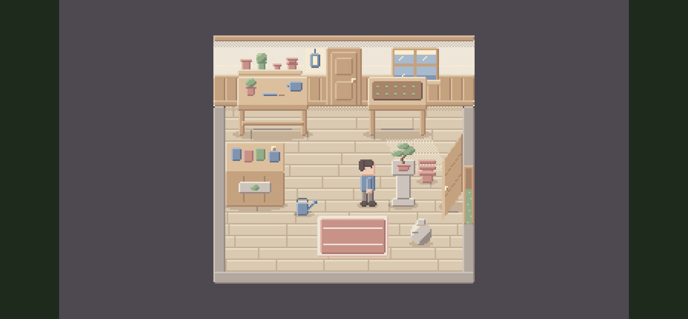

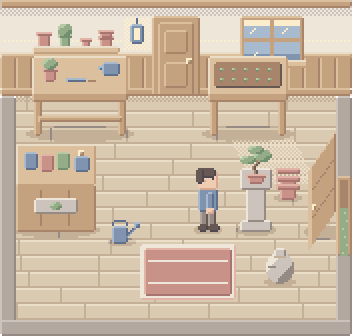


### 3. Inked (hand-drawn)

Authored at 4 art px per logical px (a 16 px tile is 64 art px) and shown with smooth (bilinear) scaling, never nearest-neighbour, so no pixel grid is visible anywhere. Ink linework 1.5 to 4 art px wide that swells and thins along its length, wobbles a little and overshoots its corners as a pen does; flat fills of paper off-white under light, low-saturation washes laid at 65 percent and slightly off register; parallel hatching on shadow sides and under furniture; no gradients. Produced in the repo by a small rasteriser of our own (`art/proposal/stroke.mjs` then, `art/inked/stroke.mjs` now: seeded jittered polylines, scanline polygon fill, 3x supersampling and a box-filter downsample), with no new dependency. Looks like Don't Starve (ink lines over flat fills), Hidden Folks (ink on paper), Dordogne and Behind the Frame (hand-painted, anime-adjacent). In the 3D viewer: a toon ramp plus an outline pass, and an ink-drawn foliage sprite. On the canvas: the art layer needs smooth scaling (`image-rendering: auto` for the world camera) while the HUD font stays crisp; the prototype sprites are all replaced, so nothing 1:1 remains to clash with the ink.

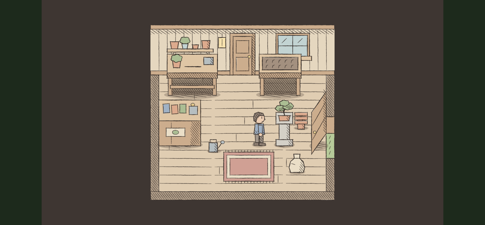

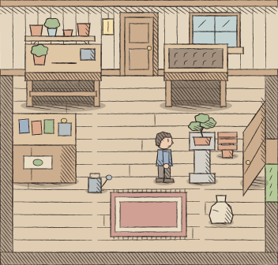

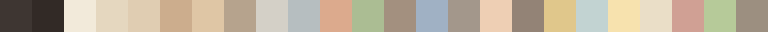

### Inked, as chosen

Drew chose Inked and asked for it "a little grungier": rougher, more uneven ink with dry-brush breaks and some spatter, washes that pool and bleed at their edges, visible paper grain, heavier shadow in corners and under furniture, and wood, cloth and pots that look worn and lived-in, at the same simplicity, readability and scale rule. The renderer is now the generator under `art/inked/` (see its README), and the look is its default `STYLE`. Both renders below come from the same seed: the lines underneath are identical, so everything that differs is the grunge.

| As proposed (#127)                         | As chosen (#137)                                        |
| ------------------------------------------ | ------------------------------------------------------- |
|  |  |

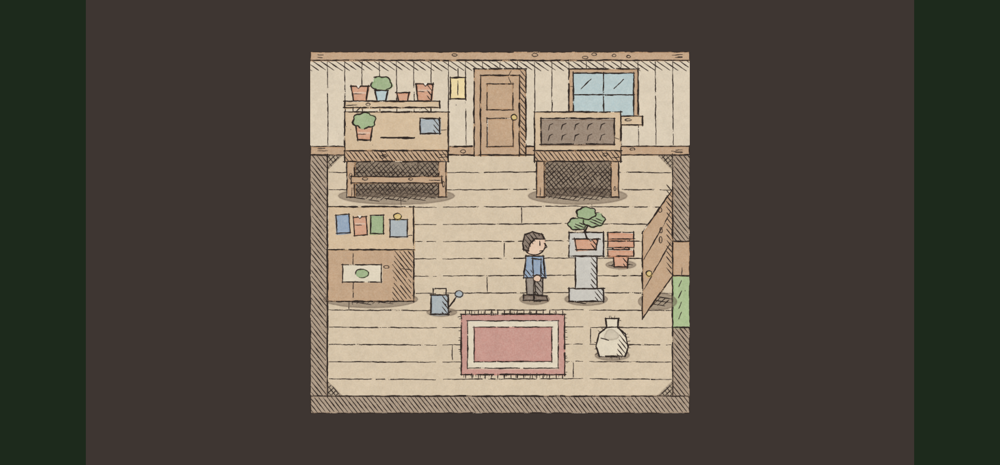

| Knob              | Proposed | Chosen                                          | What it does                                                                         |
| ----------------- | -------- | ----------------------------------------------- | ------------------------------------------------------------------------------------ |
| `jitter`          | 0.5      | 0.8                                             | sideways wobble of a line, art px                                                    |
| `overshoot`       | 1.5      | 1.8                                             | how far a line runs past its corner, art px                                          |
| `weightVariation` | 0        | 0.35                                            | pen pressure rising and falling along a line, as a fraction of its width             |
| `dryBrush`        | off      | strength 0.85, minLength 12, every 24           | lines longer than 12 logical px break dry about once per 24 px                       |
| `spatter`         | off      | chance 0.12, minWidth 2.4, dots 3, radius 2.2   | a few dots flicked beside some heavy lines                                           |
| `washPool`        | 0        | 0.25                                            | extra opacity where a wash dries at its edge: the darker rim                         |
| `washPoolWidth`   | 0        | 0.9                                             | how far in the rim reaches, logical px                                               |
| `washBleed`       | 0        | 0.8                                             | how far, at most, a wash creeps past its outline, logical px                         |
| `washGranulation` | 0        | 0.12                                            | how unevenly pigment settles inside a wash                                           |
| `grain`           | 0        | 0.09                                            | how deep the shared paper grain darkens the page                                     |
| `shadowAlpha`     | 0.35     | 0.45                                            | opacity of the ground-shadow wash                                                    |
| `crossHatch`      | off      | angle -0.75, spacing 1.7                        | a second, crossing pass of hatching in ground shadows, under furniture and in corners |
| `cornerShade`     | 0        | 7                                               | size of the shaded triangle in each floor corner, logical px                         |
| `wear`            | 0        | 1                                               | knots and splits on wood, chips and rings on pots, frayed edges and stains on cloth  |

What moved, in Drew's terms: the ink is rougher and uneven (more wobble, pressure along each line, long lines breaking dry, a little spatter); the washes pool into a darker rim and bleed softly past their outlines; paper grain shows through everything; the shadow under the tables and in the corners is cross-hatched; and the beams, door, tables, pots, rug and sack carry knots, splits, chips, rings, fraying and a stain. I checked the phone render and kept the door, the workbench and the avatar as clear as before: the avatar's lines are too short to break dry, the kiosk sign and the rug's inner borders do not wear, and the shadow cross-hatching stays under the furniture rather than on it.

#### Fonts next to the ink

A mock of the HUD badge and one panel over the chosen shed, at S22 landscape size, in three faces (`npm run art:fonts`, `art/proposal/fonts.mjs`; the game's font is unchanged): VT323, the game's pixel face; Caveat, hand-lettered; Nunito, humanist. A comparison for a later decision, not a change.

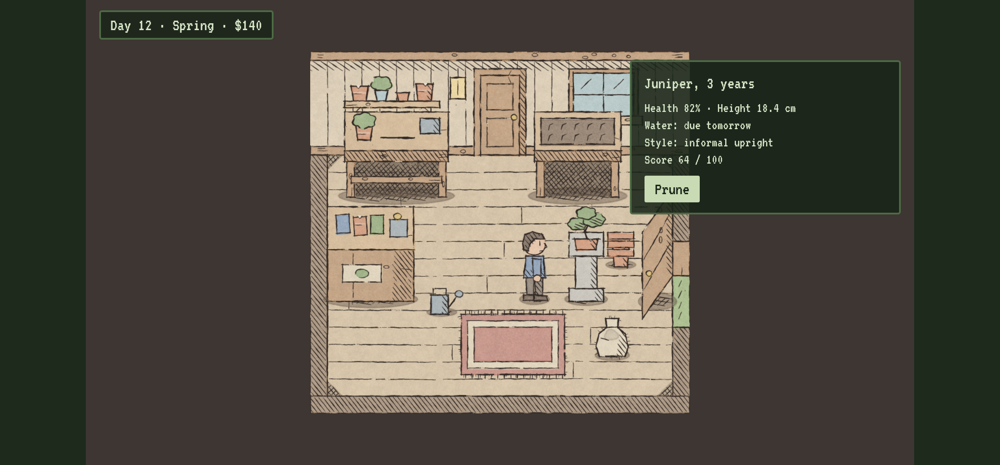

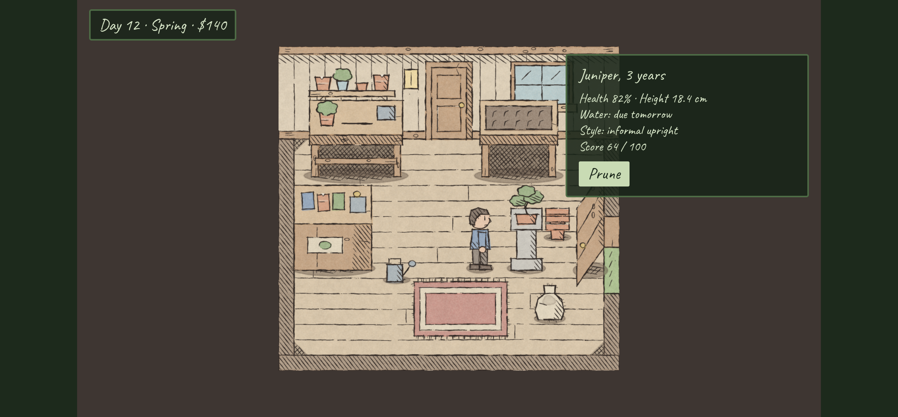

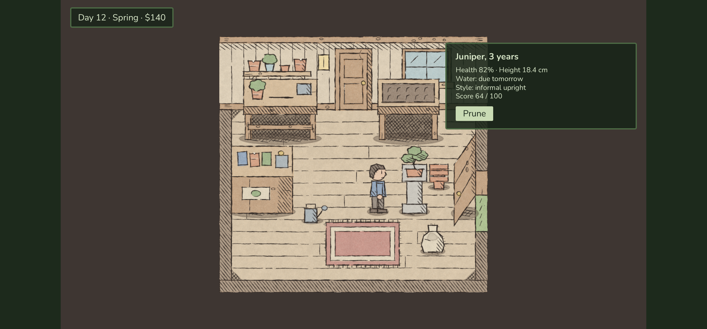

## Cost in children

- **Potting Shed:** 7 children: the player; the shed; the garden and the shed's exterior; the house rooms; the greenhouse and the placeables; the viewer's textures; the tree sprites and the pot and weather colours.
- **Soft Linen:** the same 7.
- **Inked:** the same 7, plus 2: the smooth-scaling art layer with its screenshot baselines, and the viewer's toon and outline shaders.

## Recommendation

**Potting Shed**, with Inked as the pick if its phone render is the one that charms.

- **Potting Shed** fits the brief's "remain simple" most directly and fits the build as it stands: the canvas is already pixelated, the HUD font is already a pixel font, the screenshot tests already compare 1:1 art, and the sprites are produced exactly as today's are. Seven children, none touching the renderer. Its one weak spot in the render is the side-on door leaf, whose slanted outline comes out stepped; a straighter leaf fixes it.
- **Inked** is the most finished of the three renders and the most distinctive. Choosing it costs two more children (a smooth-scaling art layer with new screenshot baselines, and a toon-and-outline pass in the viewer) and raises one question the render does not answer: the VT323 pixel font next to ink art. A hand-lettered or humanist font would want its own decision. The wobble is generated, so across six rooms and the garden it must be kept varied or it reads as a pattern.
- **Soft Linen** is not recommended: without outlines its high-key tones sit too close together for a phone in daylight (the sack and the pedestal nearly vanish into the floor), and raising its contrast turns it into Potting Shed without the outlines.

## How to regenerate

```bash
npm run art:proposal
```

Deterministic: every random choice comes from a seeded generator, so a rerun reproduces the committed PNGs byte for byte.
