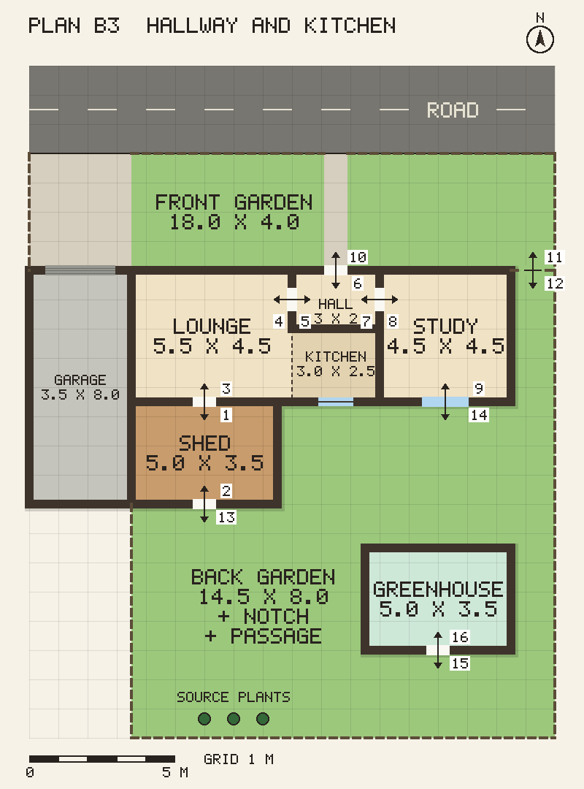

# Site plan

The whole property seen from above with north up, in which every door pair agrees with the drawing. The rooms' door positions and the arrival points in the game follow the door table below.

## Rules every plan obeys

- North is up in every room, so a room's top wall is its north wall.
- A door pair is mutually consistent: leaving a room through its south wall arrives through the north side of the room that lies south of it, and the same for the other three directions.
- A door in a north or south wall is drawn front-on; a door in an east or west wall is drawn side-on, and the player passes through it sideways.
- Arrival is just inside the far door, facing into the room.
- Room sizes are real metres. The scale rule turns them into tiles at 1 tile = 16 logical px = 50 cm.

Coordinates below are metres, x east and y south, with the house's north-west corner at 0, 0. Door positions are the centre of the door in metres along the wall from its west end (north and south walls) or its north end (east and west walls). Each door's number in the drawing is its row in the door table, written inside the room the row belongs to. Glazed doors are the 1.6 m blue double gap; every other door is a 0.8 m gap.

## Plan B3: Hallway and kitchen

The house is a row of lounge, hallway and study (0 .. 13 x 0 .. 4.5): the hallway is 3 m wide by 2 m deep, flush with the front of the house, with a kitchen behind it, open plan to the lounge, and a window onto the back garden. The shed lies south of the lounge and the closed garage west of both; the front garden runs along the road to the north, and the back garden wraps the house's east end and the shed's south side, with a freestanding greenhouse in its lawn. The buildings are drawn as solids with shadows because they are objects seen from the gardens. In the drawing the hallway is labelled HALL to fit beside its three doors, the kitchen is the darker floor behind a dashed line that marks where the lounge ends (no wall, no door), and the window is the blue gap with a pane line in the kitchen's south wall.

| Room | x | y | Interior |
| --- | --- | --- | --- |
| Lounge (walkable with the kitchen as one room) | 0 .. 5.5 | 0 .. 4.5 | 5.5 x 4.5 |
| Hallway | 5.5 .. 8.5 | 0 .. 2 | 3.0 x 2.0 |
| Kitchen (open plan, part of the lounge) | 5.5 .. 8.5 | 2 .. 4.5 | 3.0 x 2.5 |
| Study | 8.5 .. 13 | 0 .. 4.5 | 4.5 x 4.5 |
| Shed | 0 .. 5 | 4.5 .. 8 | 5.0 x 3.5 |
| Garage (closed, no room yet) | −3.5 .. 0 | 0 .. 8 | 3.5 x 8.0 |
| Front garden | −3.5 .. 14.5 | −4 .. 0 | 18.0 x 4.0: drive (x −3.5 .. 0), 0.8 m path at x 7 (paving 6.6 .. 7.4), lawn |
| Back garden | 13 .. 14.5, 5 .. 14.5 and 0 .. 14.5 | 0 .. 4.5, 4.5 .. 8 and 8 .. 16 | 1.5 x 4.5 passage, 9.5 x 3.5 notch and 14.5 x 8.0 lawn |
| Greenhouse | 8 .. 13 | 9.5 .. 13 | 5.0 x 3.5 (freestanding in the lawn) |
| Road (drawn, not walked) | −3.5 .. 14.5 | −7 .. −4 | 18.0 x 3.0 |

**The kitchen is part of the lounge, not a room of its own.** The lounge-kitchen is one walkable room keyed `lounge`, an L whose `bounds` are the rectangle 0 .. 8.5 x 0 .. 4.5 with the hallway's rectangle (5.5 .. 8.5 x 0 .. 2) solid, the same trick the back garden uses for the house and shed footprints. The lounge's door to the hallway (row 4) is then a door in that solid rect's west face, which `landing()` measures from. A separate kitchen room with an open edge to the lounge would need a doorless room transition the room model does not have, and walking from the sofa to the kettle would cut the screen; one room keeps the walk continuous and adds no room key.

Sizes at 1 tile = 50 cm: the lounge-kitchen is 17 x 9 tiles with a 6 x 4 tile bite out of its north-east corner, the hallway 6 x 4 tiles (room for its runner and console table along the south wall between the side doors), the kitchen 6 x 5 tiles (a 60 cm counter run under the window and up the east wall leaves about 4.5 x 3.5 tiles of floor), the study 9 x 9 tiles.

| # | Room | Wall | Position | Leads to | Arrival |
| --- | --- | --- | --- | --- | --- |
| 1 | Shed | N | 2.5 | Lounge, S wall at 2.5 | just inside the lounge's south door, facing north |
| 2 | Shed | S | 2.5 | Back garden, N edge of the lawn at x 2.5 (y 8) | just inside the lawn's north edge, facing south |
| 3 | Lounge | S | 2.5 | Shed, N wall at 2.5 | just inside the shed's north door, facing south |
| 4 | Lounge | E (the hallway's W wall, x 5.5) | 1.0 | Hallway, W wall at 1.0 | just inside the hallway's west door, facing east |
| 5 | Hallway | W | 1.0 | Lounge, E wall at 1.0 (x 5.5) | just inside the lounge's east door, facing west |
| 6 | Hallway | N (front door) | 1.5 (x 7) | Front garden, S edge at x 7 (y 0), the top of the path | just inside the front garden's south edge, facing north |
| 7 | Hallway | E | 1.0 | Study, W wall at 1.0 | just inside the study's west door, facing east |
| 8 | Study | W | 1.0 | Hallway, E wall at 1.0 | just inside the hallway's east door, facing west |
| 9 | Study | S (glazed double) | 2.25 (x 10.75) | Back garden, N edge of the notch at x 10.75 (y 4.5) | just inside the notch's north edge, facing south |
| 10 | Front garden | S edge | x 7 (y 0) | Hallway, N wall at 1.5 | just inside the hallway's front door, facing south |
| 11 | Front garden | S edge (side gate) | x 13.5 (y 0) | Back garden, N edge of the passage at x 13.5 | just inside the gate, in the passage, facing south |
| 12 | Back garden | N edge of the passage (side gate) | x 13.5 (y 0) | Front garden, S edge at x 13.5 | just inside the gate, facing north |
| 13 | Back garden | N edge of the lawn | x 2.5 (y 8) | Shed, S wall at 2.5 | just inside the shed's south door, facing north |
| 14 | Back garden | N edge of the notch | x 10.75 (y 4.5) | Study, S glazed doors at 2.25 | just inside the study's glazed doors, facing north |
| 15 | Back garden | the greenhouse's S face, in the lawn | x 10.5 (y 13) | Greenhouse, S wall at 2.5 | just inside the greenhouse's south door, facing north |
| 16 | Greenhouse | S | 2.5 (x 10.5) | Back garden, the lawn just south of the greenhouse at x 10.5 | just outside the greenhouse's door, facing south |
| W | Lounge (the kitchen) | S (window, 1.2 m) | 7.0 (x 7, the kitchen's centre) | nothing: a window, not a door; it looks onto the notch's north edge, seen from the back garden as glass in the house's back face | none |

The side gate stands at x 13.5, the middle of the passage's walkable metre: the east fence's band takes the passage's last 0.5 m, so at 13.75 the landing in the passage would overlap the fence.

The loop closes: in at the front door (10) to the hallway, west into the lounge (5) and south through the shed (3, then 2) to the back garden, or east into the study (7) and out of its glazed doors (9); up the passage, through the gate (12) into the front garden and back in at the front door (10). The garage's roller door (N wall, 2.4 m, centred at x −1.75, onto the drive) is drawn closed from the front garden and the road and leads to no room. A new game starts in the shed.

Saves: trees are keyed by display-spot names and room keys, and the kitchen is part of `lounge`, so the layout needs no tree migration; placed greenhouse furniture sits on the greenhouse's 10 x 7 placement grid, which the version 6 migration fits saves to.

## How to regenerate

`npm run art:site-plan`, deterministic.
