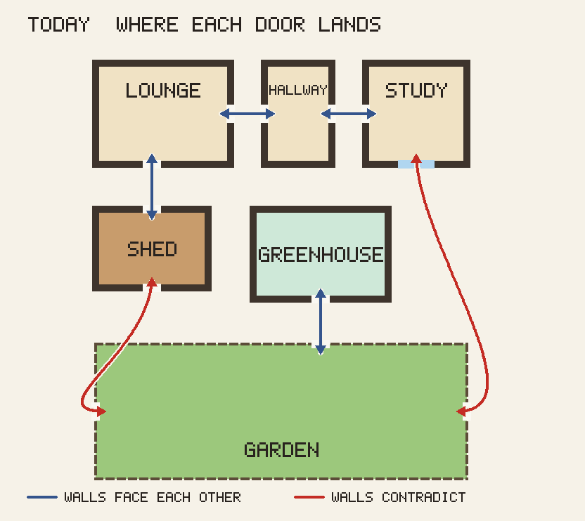
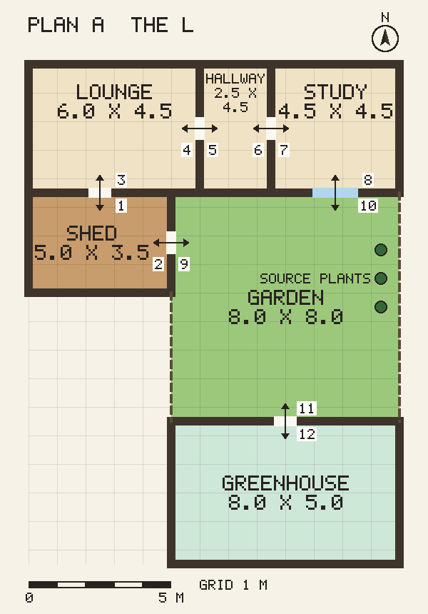
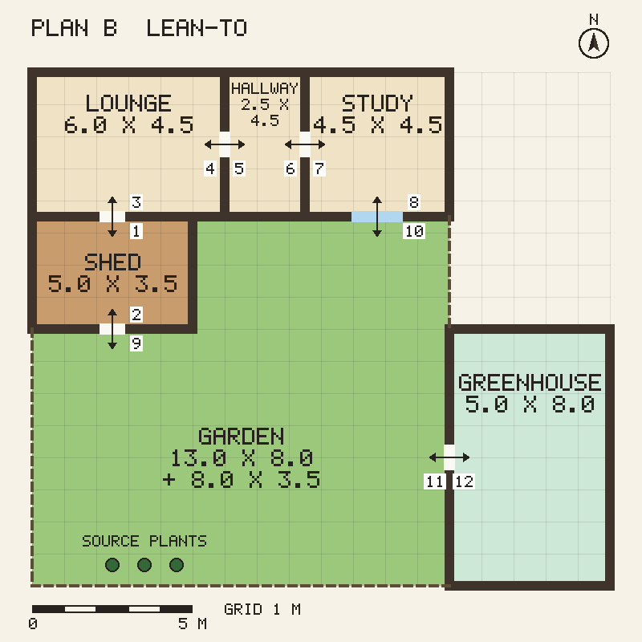
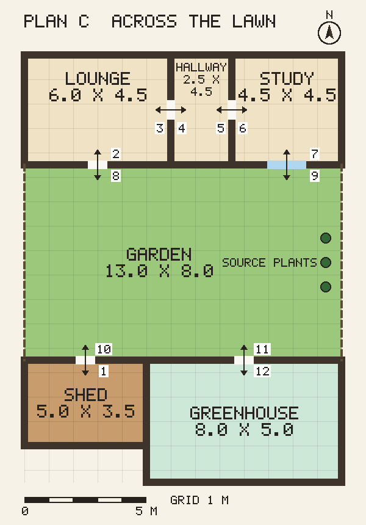

# Site plan: candidate layouts

Backlog: agentic-gaming#129. Three candidate layouts of the whole property, seen from above with north up, in which every door pair agrees with the drawing. One is to be picked; the rooms' door positions and the arrival points in the game then follow the chosen table.

## The problem

Leave the garden through its west fence and you arrive in the shed through its bottom wall, as if the shed lay south of the garden rather than west of it. Walk the house from the lounge through the hallway to the study and step out of the study's south glazed doors, and you land at the garden's east fence rather than its north edge, so the house sits both north and east of the lawn. The greenhouse hangs off the garden's top fence, which would put it between the garden and the house, yet it has no relation to the house at all. (In the drawing, blue curves join walls that face each other and red curves join walls that contradict.)

## Rules every plan obeys

- North is up in every room, so a room's top wall is its north wall.
- A door pair is mutually consistent: leaving a room through its south wall arrives through the north side of the room that lies south of it, and the same for the other three directions.
- A door in a north or south wall is drawn front-on; a door in an east or west wall is drawn side-on, and the player passes through it sideways.
- Arrival is just inside the far door, facing into the room.
- Room sizes are real metres. The scale rule turns them into tiles at 1 tile = 16 logical px = 50 cm.

Coordinates below are metres, x east and y south, with the house's north-west corner at 0, 0. Door positions are the centre of the door in metres along the wall from its west end (north and south walls) or its north end (east and west walls). Each door's number in a drawing is its row in that layout's table, written inside the room the row belongs to. Glazed doors are the 1.6 m blue double gap; every other door is a 0.8 m gap.

## Plan A: The L

| Room | x | y | Interior |
| --- | --- | --- | --- |
| Lounge | 0 .. 6 | 0 .. 4.5 | 6.0 x 4.5 |
| Hallway | 6 .. 8.5 | 0 .. 4.5 | 2.5 x 4.5 |
| Study | 8.5 .. 13 | 0 .. 4.5 | 4.5 x 4.5 |
| Shed | 0 .. 5 | 4.5 .. 8 | 5.0 x 3.5 |
| Garden | 5 .. 13 | 4.5 .. 12.5 | 8.0 x 8.0 |
| Greenhouse | 5 .. 13 | 12.5 .. 17.5 | 8.0 x 5.0 |

The garden sits in the crook of the L: bounded north by the lounge's remaining south wall (x 5 .. 6) and the hallway's and study's south walls, west by the shed's east wall (y 4.5 .. 8) and a fence below it, east by a fence at x 13, and south by the greenhouse. The source plants stand along the east fence.

| # | Room | Wall | Position | Leads to | Arrival |
| --- | --- | --- | --- | --- | --- |
| 1 | Shed | N | 2.5 | Lounge, S wall at 2.5 | just inside the lounge's south door, facing north |
| 2 | Shed | E | 1.75 | Garden, W edge at 1.75 (y 6.25) | just inside the garden's west edge, facing east |
| 3 | Lounge | S | 2.5 | Shed, N wall at 2.5 | just inside the shed's north door, facing south |
| 4 | Lounge | E | 2.25 | Hallway, W wall at 2.25 | just inside the hallway's west door, facing east |
| 5 | Hallway | W | 2.25 | Lounge, E wall at 2.25 | just inside the lounge's east door, facing west |
| 6 | Hallway | E | 2.25 | Study, W wall at 2.25 | just inside the study's west door, facing east |
| 7 | Study | W | 2.25 | Hallway, E wall at 2.25 | just inside the hallway's east door, facing west |
| 8 | Study | S (glazed double) | 2.25 (x 10.75) | Garden, N edge at x 10.75 | just inside the garden's north edge, facing south |
| 9 | Garden | W edge | y 6.25 | Shed, E wall at 1.75 | just inside the shed's east door, facing west |
| 10 | Garden | N edge | x 10.75 | Study, S glazed doors at 2.25 | just inside the study's glazed doors, facing north |
| 11 | Garden | S edge | x 9 | Greenhouse, N wall at 4.0 | just inside the greenhouse's north door, facing south |
| 12 | Greenhouse | N | 4.0 (x 9) | Garden, S edge at x 9 | just inside the garden's south edge, facing north |

What changes from today:

- Every door pair survives.
- The shed's garden door moves from its south wall to its east wall and is seen side-on.
- The garden's door to the study moves from the east fence to the north edge.
- The garden's greenhouse door moves from the north fence to the south edge, and the greenhouse's door from its south wall to its north wall.
- The greenhouse's 22 x 10 placement grid becomes 16 x 10, so placed items in columns 16 and beyond need a save migration to version 6.

## Plan B: Lean-to

| Room | x | y | Interior |
| --- | --- | --- | --- |
| Lounge | 0 .. 6 | 0 .. 4.5 | 6.0 x 4.5 |
| Hallway | 6 .. 8.5 | 0 .. 4.5 | 2.5 x 4.5 |
| Study | 8.5 .. 13 | 0 .. 4.5 | 4.5 x 4.5 |
| Shed | 0 .. 5 | 4.5 .. 8 | 5.0 x 3.5 |
| Garden | 5 .. 13 and 0 .. 13 | 4.5 .. 8 and 8 .. 16 | L: 8.0 x 3.5 notch plus 13.0 x 8.0 |
| Greenhouse | 13 .. 18 | 8 .. 16 | 5.0 x 8.0 (turned) |

The garden is an L-shaped lawn: a notch beside the shed under the hallway and study, opening onto a 13 x 8 m lawn below. Fences run along its east side above the greenhouse (x 13, y 4.5 .. 8), its west side (x 0) and its south side (y 16). The source plants stand along the south fence.

| # | Room | Wall | Position | Leads to | Arrival |
| --- | --- | --- | --- | --- | --- |
| 1 | Shed | N | 2.5 | Lounge, S wall at 2.5 | just inside the lounge's south door, facing north |
| 2 | Shed | S | 2.5 | Garden, N edge at x 2.5 (y 8) | just inside the garden's north edge, facing south |
| 3 | Lounge | S | 2.5 | Shed, N wall at 2.5 | just inside the shed's north door, facing south |
| 4 | Lounge | E | 2.25 | Hallway, W wall at 2.25 | just inside the hallway's west door, facing east |
| 5 | Hallway | W | 2.25 | Lounge, E wall at 2.25 | just inside the lounge's east door, facing west |
| 6 | Hallway | E | 2.25 | Study, W wall at 2.25 | just inside the study's west door, facing east |
| 7 | Study | W | 2.25 | Hallway, E wall at 2.25 | just inside the hallway's east door, facing west |
| 8 | Study | S (glazed double) | 2.25 (x 10.75) | Garden, N edge at x 10.75 (y 4.5) | just inside the garden's north edge, facing south |
| 9 | Garden | N edge | x 2.5 (y 8) | Shed, S wall at 2.5 | just inside the shed's south door, facing north |
| 10 | Garden | N edge | x 10.75 (y 4.5) | Study, S glazed doors at 2.25 | just inside the study's glazed doors, facing north |
| 11 | Garden | E edge | y 12 | Greenhouse, W wall at 4.0 | just inside the greenhouse's west door, facing east |
| 12 | Greenhouse | W | 4.0 (y 12) | Garden, E edge at y 12 | just inside the garden's east edge, facing west |

What changes from today:

- Every door pair survives.
- Every door between the house, the shed and the garden is front-on: the shed's garden door stays in its south wall, and the garden's door to it moves from the west fence to the north edge.
- The garden's door to the study moves from the east fence to the north edge.
- The greenhouse's door moves from its south wall to its west wall and the garden's from the north fence to the east edge; these, like the house's internal doors, are seen side-on.
- The garden becomes an L-shaped lawn.
- The greenhouse turns 90 degrees, so its placement grid becomes 10 x 16 and placed items need a migration that transposes them.

## Plan C: Across the lawn

| Room | x | y | Interior |
| --- | --- | --- | --- |
| Lounge | 0 .. 6 | 0 .. 4.5 | 6.0 x 4.5 |
| Hallway | 6 .. 8.5 | 0 .. 4.5 | 2.5 x 4.5 |
| Study | 8.5 .. 13 | 0 .. 4.5 | 4.5 x 4.5 |
| Garden | 0 .. 13 | 4.5 .. 12.5 | 13.0 x 8.0 |
| Shed | 0 .. 5 | 12.5 .. 16 | 5.0 x 3.5 |
| Greenhouse | 5 .. 13 | 12.5 .. 17.5 | 8.0 x 5.0 |

The garden lies directly south of the house, fenced at x 0 and x 13. The shed stands apart at the south-west and the greenhouse at the south-east, both opening north onto the lawn. There is no door between the shed and the lounge; the lounge has a back door onto the garden instead. The source plants stand along the east fence.

| # | Room | Wall | Position | Leads to | Arrival |
| --- | --- | --- | --- | --- | --- |
| 1 | Shed | N | 2.5 | Garden, S edge at x 2.5 | just inside the garden's south edge, facing north |
| 2 | Lounge | S | 3.0 | Garden, N edge at x 3.0 | just inside the garden's north edge, facing south |
| 3 | Lounge | E | 2.25 | Hallway, W wall at 2.25 | just inside the hallway's west door, facing east |
| 4 | Hallway | W | 2.25 | Lounge, E wall at 2.25 | just inside the lounge's east door, facing west |
| 5 | Hallway | E | 2.25 | Study, W wall at 2.25 | just inside the study's west door, facing east |
| 6 | Study | W | 2.25 | Hallway, E wall at 2.25 | just inside the hallway's east door, facing west |
| 7 | Study | S (glazed double) | 2.25 (x 10.75) | Garden, N edge at x 10.75 | just inside the garden's north edge, facing south |
| 8 | Garden | N edge | x 3.0 | Lounge, S wall at 3.0 | just inside the lounge's back door, facing north |
| 9 | Garden | N edge | x 10.75 | Study, S glazed doors at 2.25 | just inside the study's glazed doors, facing north |
| 10 | Garden | S edge | x 2.5 | Shed, N wall at 2.5 | just inside the shed's north door, facing south |
| 11 | Garden | S edge | x 9 | Greenhouse, N wall at 4.0 | just inside the greenhouse's north door, facing south |
| 12 | Greenhouse | N | 4.0 (x 9) | Garden, S edge at x 9 | just inside the garden's south edge, facing north |

What changes from today:

- The shed-to-lounge door is removed and the lounge gets a back door, so the walk from the shed to the lounge becomes two room changes through the garden, and every browser test that walks shed to lounge changes.
- The shed's garden door moves from its south wall to its north wall, and the garden's door to it from the west fence to the south edge.
- The garden's door to the study moves from the east fence to the north edge.
- The greenhouse's door moves from its south wall to its north wall, and the garden's from the north fence to the south edge.
- The greenhouse's placement grid becomes 16 x 10, as in Plan A.

## Recommendation

**Plan A, The L.** Every door pair the game has today survives, including the one-hop shed-to-lounge door the tutorial's first steps lean on, and the garden keeps its west door to the shed, so the shed exterior drawn for it stays where it is and is redrawn side-on. Three doors change wall. Plan B keeps every door between the buildings and the garden front-on, but bends the garden into an L and turns the greenhouse, which transposes its placement grid. Plan C is the most realistic property and the costliest: it removes the shed-to-lounge door, so every walk between the workshop and the display room crosses the garden, and most browser walks change with it.

## Save compatibility

Tree locations are keyed by display-spot names and room keys, not coordinates, so trees need no migration under any layout. Placed greenhouse furniture sits on the greenhouse's placement grid, and the grid changes shape under every layout, so placed furniture needs a migration whichever plan is chosen.

## How to regenerate

`npm run art:site-plan`, deterministic.
